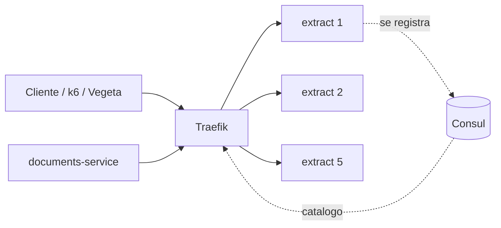

# extract-service (v1.1)

Microservicio sin estado que extrae el texto de un PDF. Trabajo práctico de Desarrollo de Software (UTN Facultad Regional San Rafael): test de carga, estrés y optimización.

Las mediciones, las decisiones de diseño y el análisis del cuello de botella están en [`informe.md`](informe.md).

## Inicio rápido

Requisitos: Docker con Compose v2 (se usa `--wait`) y unos 4 GB de RAM libres. Las 5 réplicas tienen un tope de 1 GiB cada una; en la práctica usan bastante menos.

Para levantar el sistema completo en orden (infra, extract y documents), lo recomendado es `make up` en `pdf_extractext-infra`: ver [Levantar el sistema completo](https://github.com/juandelosrios124/pdf_extractext-infra#levantar-el-sistema-completo). Lo que sigue levanta solo este stack. En los dos casos, el `.env` de este repo tiene que tener el token de Consul (ver [Service discovery con Consul](#service-discovery-con-consul)).

```bash
git clone https://github.com/juandelosrios124/extract-service.git
cd extract-service
git checkout v1.1

# Red externa compartida con Consul, Traefik y documents-service: una sola vez
# por maquina. Si ya existe (la pudo crear otro repo), ignorar el error.
docker network create mired

docker compose up --build -d --wait
```

Levanta **5 réplicas** (1,0 CPU y 1 GiB cada una). Este compose **no publica ningún puerto**: el punto de entrada es **Traefik**, que vive en el repo de [infra](https://github.com/juandelosrios124/pdf_extractext-infra) y descubre las réplicas por el catálogo de Consul. Hay que levantarlo ahí:

```bash
docker compose up -d --wait        # en pdf_extractext-infra: Consul y Traefik
```

Traefik queda publicado en `http://127.0.0.1:8080` (el tráfico) y su dashboard en `http://127.0.0.1:8081`. Probar un pedido:

```bash
curl -s -H "Content-Type: application/pdf" --data-binary @tests/stress/pdfs/Filosofia_Lean.pdf http://127.0.0.1:8080/extract | head -c 300
```

En PowerShell: `curl.exe -s -H "Content-Type: application/pdf" --data-binary "@tests/stress/pdfs/Filosofia_Lean.pdf" http://127.0.0.1:8080/extract`.

Se usa `127.0.0.1` y no `localhost` porque Traefik se publica solo en IPv4 y `localhost` puede resolver a `::1`.

Estado y limpieza:

```bash
docker compose ps        # 5 réplicas "healthy"
docker compose down
```

## API

| Método | Ruta | Descripción |
|---|---|---|
| POST | `/extract` | Recibe un PDF como cuerpo binario (`Content-Type: application/pdf`) o como `multipart/form-data` (campo `file`) y responde `{"content": "...", "page_count": N}`. `content` es texto plano |
| GET | `/health` | **Liveness**: el proceso está vivo. Lo usa el `HEALTHCHECK` de Docker |
| GET | `/health/ready` | **Readiness**: además, el hilo de extracción no está trabado. `503` si lo está. Lo usa el check de Consul, y con eso Traefik saca a la réplica del balanceo |

Errores: `400` (sin PDF o PDF inválido), `413` (supera `MAX_UPLOAD_SIZE`), `422` (más páginas que `MAX_PAGES`) y `503` con `Retry-After: 1` cuando el servicio está saturado (sin cupo, pedido vencido en la cola, o extracción cortada por `EXTRACTION_DEADLINE`). Un `503` indica reintentar más tarde; no es una falla del servicio. Un `422`, en cambio, no se arregla reintentando: el documento es el problema, y por eso no lleva `Retry-After`.

**Correlación.** Todo pedido acepta el header `X-Request-ID`. Si llega, se respeta; si no, se genera uno. El id vuelve en la respuesta y aparece en cada línea de log del pedido, incluido el access log de uvicorn y lo que loguea la extracción. Es el mismo header que propaga `documents-service`, así que un pedido se puede seguir por los dos servicios con el mismo id.

## Configuración y valores por defecto

Todo se configura por variables de entorno (Twelve-Factor). Los valores por defecto ya están en `docker-compose.yml` y documentados en `.env.example`. Para cambiarlos, copiá `.env.example` a `.env` o exportá la variable antes de `docker compose up`. Los valores por defecto del código están en `extractor/config.py` y son los mismos, así que fuera de Compose el servicio arranca con esta misma configuración.

| Variable de Compose | Valor | Por qué |
|---|---|---|
| `EXTRACT_REPLICAS` | `5` | Máximo permitido por la consigna |
| `EXTRACT_CPUS` | `1.0` | Límite de CPU por réplica pedido por la consigna; define cuántos hilos conviene usar |
| `EXTRACT_MEMORY` | `1g` | Tope de la consigna (512 MB a 1 GB); el uso real es mucho menor |
| `EXTRACT_THREAD_POOL_SIZE` | `1` | Un worker por núcleo asignado. La extracción consume CPU: con 4 hilos sobre 1,0 CPU solo había contención y latencias de 22 s o más |
| `EXTRACT_MAX_CONCURRENT_UPLOADS` | `8` | Cada réplica atiende como máximo 8 pedidos a la vez; acota la memoria y evita acumular pedidos que van a expirar |
| `EXTRACT_UPLOAD_SLOT_TIMEOUT` | `5` | Segundos que un pedido espera un cupo (sin leer el cuerpo) antes de recibir `503` |
| `EXTRACT_MAX_QUEUE_WAIT` | `15` | Si un pedido ya esperó 15 s antes de empezar a extraer, se descarta con `503` sin gastar CPU |
| `EXTRACT_EXTRACTION_DEADLINE` | `8` | Segundos máximos de extracción, chequeados **entre páginas**. Pasado eso, `503`: sin esto un PDF pesado congela la réplica, porque la extracción corre en el pool y no se puede cancelar |
| `EXTRACT_READINESS_STUCK_AFTER` | `12` | Segundos tras los cuales se considera que la extracción se trabó y `/health/ready` responde `503`. **Mayor que el deadline** a propósito: por debajo, una extracción legítima marcaría mal a una réplica sana |
| `EXTRACT_MAX_PAGES` | `10000` | Tope duro de páginas. Por encima se responde `422` sin extraer nada. No está afinado contra el deadline: es un techo para entradas absurdas |
| `EXTRACT_MAX_UPLOAD_SIZE` | `52428800` | 50 MiB; el cuerpo se corta apenas se supera |
| `EXTRACT_LOG_LEVEL` | `INFO` | Logs a stdout |
| `EXTRACT_LOG_FORMAT` | `json` | `json` emite un objeto por línea con `request_id`, para recolectores de logs; `text` queda legible en una terminal. El default del código es `text` |
| `SHARED_NETWORK` | `mired` | Nombre de la red externa compartida con Consul y documents-service. Es la misma variable en los tres repos: si se cambia, hay que cambiarla en todos |
| `CONSUL_ENABLED` | `true` | Autorregistro en Consul, que es cómo Traefik descubre las réplicas (#32). En `false` el servicio funciona igual, pero queda sin publicar |
| `CONSUL_HTTP_ADDR` | `http://consul:8500` | Agente de Consul, visto desde `mired` |
| `CONSUL_HTTP_TOKEN` | *(vacío)* | Token de ACL de Consul. Va en el `.env` (no versionado), con el valor de `CONSUL_EXTRACT_TOKEN` del `.env` de infra: ver [Qué va en el `.env` de cada repo](https://github.com/juandelosrios124/pdf_extractext-infra#qué-va-en-el-env-de-cada-repo) |

Los timeouts del borde ya no son de este repo: los define Traefik y están en el repo de [infra](https://github.com/juandelosrios124/pdf_extractext-infra), documentados en su tabla «Presupuesto de timeouts».

**Por qué esta configuración.** En la prueba de la cátedra (Vegeta, 50 req/s durante 30 s) la configuración sin límites logró 68,93 % de éxito y 17,30 req/s; con el límite de 8 por réplica, **76,13 % y 20,06 req/s**, con 262 timeouts contra 465 y 96 respuestas `503` controladas. La referencia de la cátedra es 66,53 % y 16,65 req/s. Los valores 8 cupos, 5 s de espera, 15 s de descarte y 8 s de deadline son un primer ajuste razonado, no un óptimo: los tres tiempos suman los 23 s que le tocan a extract en el presupuesto de punta a punta (cliente 30 s > documents 27 s > Traefik 25 s > extract 23 s), definido en el repo de [infra](https://github.com/juandelosrios124/pdf_extractext-infra). Las mediciones del informe se hicieron con 15 s y 20 s; volver a medirlas es la #38.

Para reproducir la configuración **sin límites** (A):

```bash
EXTRACT_MAX_CONCURRENT_UPLOADS=0 EXTRACT_MAX_QUEUE_WAIT=1000 docker compose up -d --force-recreate --wait
```

En PowerShell: `$env:EXTRACT_MAX_CONCURRENT_UPLOADS="0"; $env:EXTRACT_MAX_QUEUE_WAIT="1000"; docker compose up -d --force-recreate --wait`.

## Red compartida

Desde la #33 cada réplica vive en **una sola** red:

- `mired`, la red Docker **externa** que comparten los tres repos del trabajo práctico ([pdf_extractext-infra](https://github.com/juandelosrios124/pdf_extractext-infra), este y [documents-service](https://github.com/OlivettiSantino/documents-service)). Gracias a ella Consul puede chequear la IP de cada réplica y `documents-service` puede llamarlas directo, sin pasar por el puerto publicado en el host.

Al ser externa, hay que crearla **una sola vez por máquina y antes** del primer `docker compose up`; es el único paso previo que agrega:

```bash
docker network create mired
```

`docker compose down` no la borra, justamente porque la comparten los otros stacks. El nombre se configura con `SHARED_NETWORK` (default `mired`), variable común a los tres repos.

Desde cualquier contenedor de `mired`, las réplicas se alcanzan en `http://extract:8001`: el DNS de Docker devuelve una IP por réplica. También responden al alias `extract-service`, pero el nombre canónico es `extract`.

Antes había además una red privada del proyecto, por donde entraba Caddy. Con Caddy eliminado (#33) no quedó nadie que la use: el tráfico entra por Traefik, que también está en `mired`, así que las réplicas se declaran solo ahí.

### Service discovery con Consul

Cada réplica se registra sola en [Consul](https://github.com/juandelosrios124/pdf_extractext-infra) al arrancar y se desregistra al apagarse. **Viene encendido** en el compose desde la #32, porque es así como Traefik descubre las réplicas. Igual nunca es fatal: si Consul no está o el registro falla, la réplica arranca de todas formas y solo queda un `WARNING` en el log (el default del código, fuera de Compose, sigue siendo `false`).

El Consul de infra corre con ACLs en `default_policy = "deny"`: sin un token válido, Consul rechaza el registro y Traefik nunca rutea las réplicas, aunque Docker las muestre `healthy`. El token va en el `.env` de este repo, con el valor de `CONSUL_EXTRACT_TOKEN` del `.env` de infra (no el de management):

```dotenv
# .env de extract-service
CONSUL_HTTP_TOKEN=<valor de CONSUL_EXTRACT_TOKEN del .env de infra>
```

Después:

```bash
docker compose up -d --wait        # Compose recrea las réplicas si cambió el token
```

No hay que exportarlo en el shell ni anteponerlo al comando: Compose les da prioridad a las variables del shell sobre el `.env`, así que un valor exportado (por ejemplo, el de management) pisaría el correcto. Si las réplicas no se registran, el log lo dice:

```bash
docker compose logs extract | grep "No se pudo registrar"
```

Qué token va en cada repo: [Qué va en el `.env` de cada repo](https://github.com/juandelosrios124/pdf_extractext-infra#qué-va-en-el-env-de-cada-repo).

Lo que registra cada réplica:

| Campo | Valor | Por qué |
|---|---|---|
| `ID` | hostname del contenedor | Único por réplica, así las 5 conviven en el catálogo |
| `Name` | `extract` | El nombre con el que la busca `documents-service` |
| `Address` | su IP en `mired` | Se resuelve preguntando por qué interfaz saldría un paquete hacia Consul, en vez de confiar en el orden de `gethostbyname` |
| `Port` | `8001` | |
| `Check` | `HTTP` a `http://<IP>:8001/health`, `Interval 10s`, `Timeout 2s` | A la IP de la réplica y no a `localhost`, que desde Consul es el propio contenedor de Consul |
| `DeregisterCriticalServiceAfter` | `1m` | Un `docker kill` no da tiempo a desregistrarse: Consul la saca del catálogo por su cuenta |

Comprobar:

```bash
# Que servicios ve Consul: deberia listar "extract"
docker exec pdf_extractext-infra-consul-1 consul catalog services

# Una se cae: pasa a critical y, un minuto despues, desaparece del catalogo
docker kill extract-service-extract-1
```

La API de Consul necesita token: sin él, las lecturas devuelven `200` con `[]`, no `403`. Alcanza el de Traefik, que es de solo lectura, tomado del `.env` de infra sin imprimirlo (ver [UI y API con token](https://github.com/juandelosrios124/pdf_extractext-infra#ui-y-api-con-token)). Desde este repo, en bash:

```bash
# Leer solo esa variable, sin exportarla: un "set -a; . .env" de infra
# exportaria tambien el CONSUL_HTTP_TOKEN de management y pisaria este .env
token=$(sed -n 's/^CONSUL_TRAEFIK_TOKEN=//p' ../pdf_extractext-infra/.env)

# Las 5 replicas con su ID, su IP de mired y el estado del check (sin jq)
curl -s -H "X-Consul-Token: $token" http://127.0.0.1:8500/v1/health/service/extract | python -c "import sys,json;[print(s['Service']['ID'], s['Service']['Address'], [c['Status'] for c in s['Checks'] if c['CheckID'].startswith('service:')][0]) for s in json.load(sys.stdin)]"

# Solo las que estan passing
curl -s -H "X-Consul-Token: $token" "http://127.0.0.1:8500/v1/health/service/extract?passing"
```

En fish:

```fish
set -l token (string match -rg '^CONSUL_TRAEFIK_TOKEN=(.*)' < ../pdf_extractext-infra/.env)

curl -s -H "X-Consul-Token: $token" http://127.0.0.1:8500/v1/health/service/extract | python -c "import sys,json;[print(s['Service']['ID'], s['Service']['Address'], [c['Status'] for c in s['Checks'] if c['CheckID'].startswith('service:')][0]) for s in json.load(sys.stdin)]"

curl -s -H "X-Consul-Token: $token" "http://127.0.0.1:8500/v1/health/service/extract?passing"
```

La UI está en <http://127.0.0.1:8500/ui>. El nombre del contenedor de Consul sale del proyecto Compose de infra; si lo levantaste con otro nombre, ajustá el `docker exec`.

El token de ACL se toma de `CONSUL_HTTP_TOKEN` y viaja en el header `X-Consul-Token`; no está en el repo ni se escribe en los logs.

### Liveness y readiness

Son dos preguntas distintas, con consumidores distintos:

| | `/health` | `/health/ready` |
|---|---|---|
| Pregunta | ¿el proceso está vivo? | ¿además puede atender? |
| Mira el hilo de extracción | no | sí |
| Lo consume | `HEALTHCHECK` de Docker | check de Consul → Traefik |
| Qué pasa si falla | Docker **reinicia** el contenedor | Traefik la **saca del balanceo**, sin reiniciarla |

`/health` no mira el pool a propósito: si lo mirara, bajo carga las 5 réplicas se marcarían mal a la vez y el servicio caería completo (es la regresión que cubre `test_health.py`).

La readiness existe por una limitación concreta del `EXTRACTION_DEADLINE`: se chequea **entre páginas**, así que una sola página que cuelgue no se puede interrumpir, y con `THREAD_POOL_SIZE=1` eso deja a la réplica sin poder atender mientras `/health` sigue diciendo `ok`. `READINESS_STUCK_AFTER` (12 s) es mayor que el deadline (8 s) justamente para que solo dispare en ese caso.

```bash
curl -s 127.0.0.1:8080/health/ready
# {"status":"ready","extracting_for_seconds":0.0}
```

**Limitación conocida.** El check de Consul lleva `DeregisterCriticalServiceAfter: 1m`, así que una réplica que quede trabada más de un minuto no solo sale del balanceo: Consul la **borra del catálogo**. Como el registro se hace una sola vez, al arrancar, esa réplica no vuelve a aparecer hasta que se reinicie el contenedor. Para ese caso el `HEALTHCHECK` de Docker no ayuda, porque `/health` sigue respondiendo `ok`.

### Publicación en Traefik

El circuit breaker, el retry y el límite de concurrencia **no están en el código del servicio**: los aplica Traefik, y cada réplica los configura con los **tags que pone en su propio registro de Consul** (`traefik_tags()` en [`extractor/services/consul.py`](extractor/services/consul.py)). No se usan labels de Docker: así la configuración viaja con el registro y no con el contenedor.

Traefik corre con `providers.consulcatalog` y `exposedByDefault=false`, así que sin `traefik.enable=true` la réplica queda sin publicar. Los tags que manda:

| Tag | Variable | Valor por defecto |
|---|---|---|
| `traefik.enable=true` | — | — |
| `...routers.extract.rule` | — | `PathPrefix(`/extract`)` |
| `...routers.extract.entrypoints` | — | `web` (el otro entrypoint es el del dashboard) |
| `...routers.extract.middlewares` | — | `extract-cb,extract-retry,extract-inflight` |
| `...extract-cb.circuitbreaker.expression` | `TRAEFIK_CB_EXPRESSION` | ver abajo |
| `...extract-cb.circuitbreaker.fallbackDuration` | `TRAEFIK_CB_FALLBACK` | `10s` |
| `...extract-cb.circuitbreaker.recoveryDuration` | `TRAEFIK_CB_RECOVERY` | `10s` |
| `...extract-retry.retry.attempts` | `TRAEFIK_RETRY_ATTEMPTS` | `2` |
| `...extract-inflight.inflightreq.amount` | `TRAEFIK_INFLIGHT` | `80` |
| `...services.extract.loadbalancer.serverstransport` | — | `extract-transport@file` |

`serversTransport` es lo único que no se puede declarar por tags; lo define el provider file de infra.

**Decisión: el `503` del backpressure no abre el circuito.**

```
NetworkErrorRatio() > 0.30 || ResponseCodeRatio(500, 503, 0, 600) > 0.50
```

En Traefik el rango de `ResponseCodeRatio` es `[from, to)`: `from` incluido, `to` excluido. `(500, 503, ...)` cuenta entonces **500, 501 y 502, y deja afuera el 503**. El default que suele citarse, `(500, 600, ...)`, sí lo contaría.

Se eligió excluirlo porque **el `503` del backpressure no es una falla de la réplica: es su respuesta sana cuando está llena** (sin cupo, o pedido vencido en la cola), y siempre lleva `Retry-After: 1`. Si contara para el breaker:

- Cuanto mejor descarta carga el servicio, más probable que Traefik lo corte **del todo**. La degradación elegante se convertiría en una caída completa.
- Las 5 réplicas descartan a la vez bajo la misma carga, así que tampoco habría aislamiento: el circuito se abriría para el servicio entero.
- Con el circuito abierto Traefik responde `503` por su cuenta, el mismo código: el cliente no podría distinguir «estoy lleno, reintentá en 1 s» de «no te atiendo».

El breaker queda entonces para fallas de verdad: errores de red (réplica caída o inalcanzable) y `500`/`502`.

El `retry` de Traefik reintenta ante **error de red**, no ante un `503` de la app (sin la opción `status`, deja de reintentar en cuanto la réplica responde, cualquiera sea el código), así que no pelea con la admisión por cupos. Trae además `maxRequestBodyBytes` en 2 MiB por defecto; se comprobó que un PDF de 8,9 MB igual pasa con `200`. El `inflightreq` responde `429` al pasarse del tope y está puesto en el doble de la capacidad agregada (5 réplicas × 8 cupos) a propósito: el control primario sigue siendo la admisión por cupos de la app, que es la que está medida en el informe; el tope del borde solo acota el encolado. Es un primer valor razonado, sin afinar.


## Arquitectura



Traefik vive en el repo de infra y descubre las réplicas por el catálogo de Consul: cada una se registra al arrancar con los tags que configuran su router, su circuit breaker, su retry y su límite de concurrencia (ver [Publicación en Traefik](#publicación-en-traefik)).

Cada réplica admite como máximo `MAX_CONCURRENT_UPLOADS` pedidos, lee el cuerpo en memoria (sin escribir a disco) y extrae el texto con PyMuPDF en un pool de hilos separado del event loop. Decisiones principales:

- **PyMuPDF** y no `pypdfium2`: esta fue solo un 11,4 % más rápida, por debajo del 15 % que el equipo fijó para justificar el riesgo de cambiar.
- **Un hilo por réplica**, porque cada contenedor tiene 1,0 CPU.
- **Backpressure** con `503` y `Retry-After`, para fallar rápido en lugar de acumular pedidos.

Capas: `extractor/api` (HTTP), `extractor/services` (extracción, sin conocer HTTP) y `extractor/main.py` (composición).

## Tests

```bash
uv run pytest -q
```

Se escribieron con TDD (rojo, verde, refactor).

## Pruebas de carga

Los 4 PDFs oficiales están en `tests/stress/pdfs/` y los scripts de la cátedra, adaptados para leer la URL y la carpeta de PDFs del entorno, en `tests/stress/profesor/` (los originales, en `original/`). Con el stack levantado:

```bash
# Vegeta: 50 req/s durante 30 s, timeout de 30 s (por la red interna de Docker)
docker run --rm --network extract-service_default -v "$PWD/tests/stress:/stress" --entrypoint sh peterevans/vegeta -c "vegeta attack -targets=/stress/profesor/test_carga.txt -rate=50 -duration=30s -timeout=30s | vegeta report"

# k6: spike de 100 usuarios virtuales
k6 run tests/stress/profesor/spike_tests.js
```

En PowerShell, reemplazar `$PWD` por `${PWD}`. Recomendaciones para medir:
- Dejar la máquina enchufada y cerrar otros programas: **k6 carga los 4 PDFs en cada uno de los 100 usuarios (unos 1,4 GB)** y es sensible a la memoria disponible.
- Recrear las réplicas y esperar ~60 s antes de cada corrida.
- Una sola corrida varía unos 13 puntos de éxito: comparar promedios de varias corridas alternadas.

Los scripts `tests/stress/k6/spike.js` y `tests/stress/vegeta/attack.sh` envían los PDFs como `multipart/form-data`. Los resultados se guardan en `tests/stress/results/` (no se versiona). `tests/stress/generate_pdfs.py` genera un set sintético para diagnóstico.

## Estructura

```
extractor/            código del servicio (api, services, config, main)
extractor/services/consul.py  autorregistro de la réplica en Consul
tests/                tests unitarios
tests/stress/         PDFs oficiales, scripts de k6 y Vegeta, resultados
informe.md            informe técnico
docs/                 bitácora de mediciones
docker-compose.yml    5 réplicas con límites de recursos, en la red mired
```

## Metodología

Twelve-Factor (configuración por entorno, logs a stdout, procesos sin estado), TDD, KISS, DRY, YAGNI y SOLID; una rama por issue, commits chicos y pull requests.
