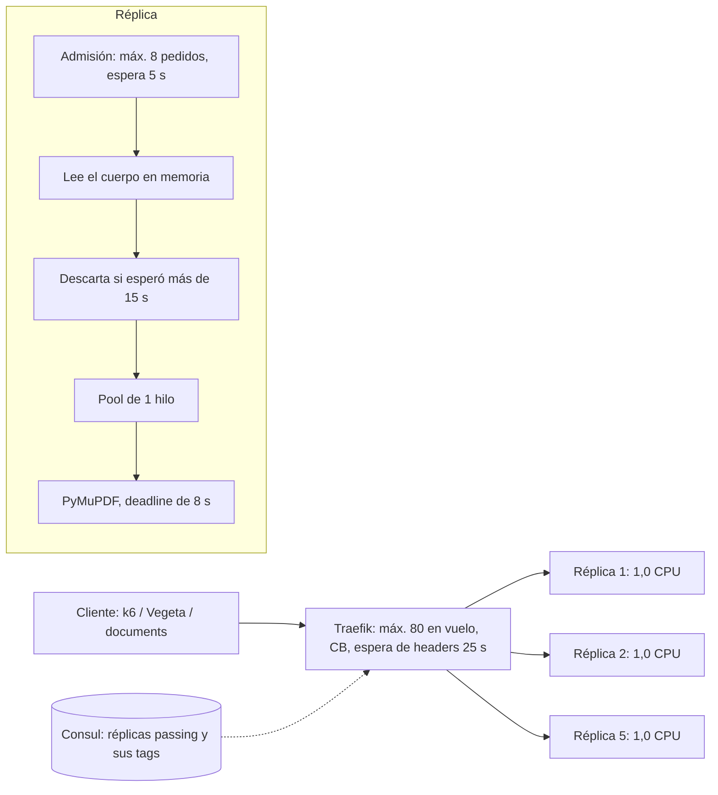

# Informe técnico: concurrencia, backpressure y límites de CPU en el microservicio `/extract`

Mediciones de la issue #38 (imagen `sha-ec5b762`, noviembre de 2026) · Desarrollo de Software · UTN Facultad Regional San Rafael
Autores: Juan Ignacio De Los Rios, Santino Olivetti

> Convenciones: lo marcado como **hipótesis** no fue aislado con un experimento propio.
> Las mediciones vigentes son las de la **issue #38** (Traefik, imagen `sha-ec5b762`, 3 corridas
> alternadas por configuración). Las de `v1.0` (Caddy, Windows, una corrida) quedan como
> **histórico** y están marcadas así.

## 1. Resumen ejecutivo

Se construyó un microservicio sin estado que extrae el texto de un PDF (FastAPI y PyMuPDF), desplegado con Docker Compose como **5 réplicas de 1,0 CPU** detrás de **Traefik**, que descubre las réplicas en Consul (hasta `v1.0` el proxy era Caddy). Con mediciones se evaluaron tres decisiones:

1. **Librería de extracción.** Se conserva **PyMuPDF**: `pypdfium2` fue un 11,4 % más rápida, por debajo del umbral del 15 % que el equipo fijó para justificar el riesgo de cambiarla.
2. **Concurrencia dentro de cada réplica.** `THREAD_POOL_SIZE=1`: un solo worker por réplica, porque cada contenedor dispone de un único núcleo equivalente (`cpus: 1.0`) y la extracción consume CPU. Con 4 hilos se observó contención y latencias extremas.
3. **Backpressure.** Se limitan a **8 los pedidos simultáneos por réplica**, con una espera máxima de **5 s** por un cupo, un descarte de los pedidos que esperaron más de **15 s** y un deadline de extracción de **8 s**. Los pedidos rechazados reciben `503` con `Retry-After` en vez de acumularse. Delante, Traefik limita a **80 los pedidos en vuelo** (`429`) y tiene un circuit breaker.

En la prueba de carga fija de la cátedra (Vegeta, 50 req/s durante 30 s, timeout de 30 s), la configuración final (**C+CB**, la de producción) **supera la referencia** en éxito, throughput y timeouts. Media (mínimo a máximo) de **3 corridas alternadas** por configuración:

| Métrica (Vegeta) | Cátedra | A: sin cupos | C: cupos de 8 | **C+CB: final** | Histórico v1.0: A / C |
|---|---|---|---|---|---|
| Tasa de éxito | 66,53 % | 79,27 % (77,07 a 80,53) | 78,53 % (76,40 a 79,60) | **78,24 % (76,40 a 79,80)** | 68,93 % / 76,13 % |
| Throughput efectivo | 16,65 req/s | 36,57 (35,24 a 37,58) | 36,23 (35,72 a 36,69) | **35,97 (35,31 a 36,35) req/s** | 17,30 / 20,06 req/s |
| Timeouts de cliente | 501 | 0 | 0 | **0** | 465 / 262 |
| `429` del inflight de Traefik | | 311 (292 a 344) | 322 (306 a 354) | **326 (303 a 352)** | no existía |
| `503` de extract (total de 3 corridas) | | 0 | 0 | **2 (cupo)** | 0 / 96 |
| `504` de Traefik | | 0 | 0 | **0** | no existía |
| Latencia P50 / P95 | 14,89 s / n/d | 1,35 / 4,07 s | 1,39 / 3,99 s | **1,16 / 4,61 s** | N/D |
| Corridas | | 3 | 3 | 3 | 1 / 1 |
| Imagen | — | `sha-ec5b762` | `sha-ec5b762` | `sha-ec5b762` | compilada desde git |

| Métrica (k6, spike de 100 usuarios) | Cátedra | A | C | **C+CB: final** | Histórico v1.0: C |
|---|---|---|---|---|---|
| Respuestas `200` por segundo | 25,35 (0 % de error) | 22,97 (22,10 a 24,46) | 25,25 (23,35 a 26,57) | **25,77 (25,17 a 26,68)** | N/D (solo se registró el total: 8,30 req/s con 0,29 % de error) |
| Mediana / P95 de los `200` | 1,88 s / 8,80 s | 2,47 / 6,84 s | 2,48 / 5,67 s | **2,30 / 5,31 s** | 8,85 s / 22,20 s |
| Éxito (`200` sobre el total) | 100 % | 6,88 % | 6,67 % | **6,77 %** | N/D (0,29 % de error) |
| Pedidos por segundo (todos) | 25,35 | 349,35 | 378,56 | **380,92** | 8,30 |
| Corridas | | 3 | 3 | 3 | 1 |
| Imagen | — | `sha-ec5b762` | `sha-ec5b762` | `sha-ec5b762` | compilada desde git |

En k6, el éxito bajo y los cientos de pedidos por segundo **no son errores del servicio**: el script de la cátedra es de modelo cerrado y sin pausas, y con 100 usuarios contra un tope de 80 en vuelo, los ~20 usuarios sobrantes reciben `429` en milisegundos y vuelven a pedir en bucle (entre 9.099 y 15.221 `429` por corrida). Por eso, para k6, lo comparable con la cátedra son los `200` por segundo y la latencia de los `200` (§5.3).

La fila «Imagen» registra qué binario se midió (ver §4): `ghcr.io/juandelosrios124/extract-service:sha-ec5b762`, digest `sha256:79793696c0f6ae7459a0fbdac7a062a2fa0e020113bbfa91271f4da5b1b1fbe6`, el código de `main` en el merge de la #40. Las mediciones históricas se hicieron compilando desde git, sin tag ni digest, en otro sistema operativo (§4): no son comparables en valor absoluto. Los números salen de `tests/stress/results/38/2026-11-06/resumen.md`.

## 2. Contexto y restricciones

- `POST /extract` recibe un PDF (cuerpo binario o `multipart/form-data`) y responde `{"content": "...", "page_count": N}`.
- Docker Compose, **hasta 5 réplicas** y límites explícitos de CPU y RAM por réplica (aquí, 1,0 CPU y 1 GiB).
- Pruebas con k6 (spike de 100 usuarios, modelo cerrado) y Vegeta (50 req/s durante 30 s con timeout de 30 s, modelo abierto) sobre los 4 PDFs oficiales de la cátedra.
- Twelve-Factor, control de concurrencia y mitigación de saturación (backpressure).

## 3. Arquitectura



Cada réplica es un proceso de FastAPI sin estado que se registra en Consul con su readiness como check y con los tags que le dicen a Traefik cómo publicarla (router, middlewares y service). Traefik solo rutea a las réplicas `passing` y, antes de llegar a una, aplica tres middlewares: el circuit breaker, el retry (que no actúa sobre `POST`, ver §5.3) y el límite de 80 pedidos en vuelo, que responde `429`. Si una réplica no manda los headers de respuesta en 25 s, Traefik responde `504`. El orden de un pedido dentro de la réplica es:

1. **Admisión:** toma un cupo (máximo `MAX_CONCURRENT_UPLOADS`). Si no hay, espera hasta `UPLOAD_SLOT_TIMEOUT` **sin leer el cuerpo** y después responde `503`.
2. **Lectura en memoria** con límite de tamaño en streaming (`MAX_UPLOAD_SIZE`, 50 MiB).
3. **Extracción** en un pool de hilos separado del event loop. Antes de empezar se verifica que el pedido no haya vencido (`MAX_QUEUE_WAIT`) y que no supere `MAX_PAGES`; durante la extracción, entre página y página, que no se haya pasado el `EXTRACTION_DEADLINE`.
4. Respuesta `200`, o `400`, `413`, `422` o `503` según el caso.

| Decisión | Alternativas | Motivo |
|---|---|---|
| 5 réplicas sin estado detrás de Traefik | Caddy (el proxy hasta `v1.0`), nginx | Traefik descubre las réplicas en el catálogo de Consul y toma la configuración de los tags de cada una (issues #32 y #33): no hay archivo del proxy que mantener al escalar, y el inflight, el CB y los timeouts se aplican en el borde |
| PyMuPDF, todo en memoria | Disco, `pypdfium2`, `pymupdf4llm` | Ver 5.1 |
| `THREAD_POOL_SIZE=1` | 4 hilos, pool de procesos | Ver 5.2 |
| Parser de multipart propio (`bytes.find`) | Parser de Starlette | El de Starlette vuelca a disco las subidas de más de 1 MB; la consigna pide evitarlo |
| Admisión por cupos y `503` con `Retry-After` | Cola sin límite | Ver 5.3 |
| Configuración por variables de entorno | Archivos de configuración | Twelve-Factor |

## 4. Entorno y metodología

- **Equipo:** Lenovo 81W3, AMD Ryzen 3 4300U (4 núcleos, 4 hilos, sin SMT), 8 GB de RAM (6,6 GiB visibles), SSD NVMe, enchufado. Servicio y generador de carga **comparten la máquina**. Es la misma notebook en todas las mediciones del equipo; lo que cambió es el sistema:
  - **#38 (vigente):** CachyOS (Linux nativo), kernel `7.3.1-1-cachyos`, Docker Engine 29.9.2 con cgroup v2, governor `schedutil`.
  - **v1.0 (histórico):** Windows; las primeras corridas con Docker Desktop y las finales con Docker Engine dentro de WSL2. Con el mismo hardware, el rendimiento absoluto es distinto, así que las dos series no se comparan en valor absoluto.
  - **Cátedra:** otro equipo, cuyo hardware no conocemos.
- **Límites y sobresuscripción:** `cpus: 1.0` equivale a una cuota de tiempo de un núcleo por contenedor, no a un núcleo fijo. En la matriz de extract los topes suman 5 × 1,0 (extract) + 0,5 (Traefik) + 1,0 (documents) + 0,5 (Mongo) = **7,0 CPU sobre 4 núcleos**, más Consul y el generador de carga, que no tienen tope (documents y Mongo quedan levantados sin carga porque `make wait-routes` exige su ruta). La CPU está sobresuscrita por diseño, igual que en v1.0 (5 réplicas sobre 4 núcleos).
- **Sistema medido (#38):** infra con Consul (ACL deny) y Traefik v3.7.17; extract ×5 (1 CPU, 1 GiB, `THREAD_POOL_SIZE=1`, readiness de la #35); documents ×1. En Traefik, el router de extract tiene los middlewares `extract-cb`, `extract-retry` (2 intentos), `extract-inflight` (80 en vuelo, `429`) y el `serversTransport` con `responseHeaderTimeout` de 25 s (`504`).
- **PDFs oficiales:**

| Archivo | Tamaño | Páginas | Extracción pura |
|---|---|---|---|
| Scrum Guide 2020 | 0,32 MB | 16 | ~0,09 s |
| Essential Kanban Condensed | 8,90 MB | 90 | ~0,22 s |
| Filosofía Lean | 0,67 MB | 42 | ~0,11 s |
| Scrum Manager (historias de usuario) | 3,83 MB | 62 | ~0,11 s |

- **Imagen medida (desde la #40):** cada medición corre una imagen publicada por la CI, no un build local, y se anota en la fila «Imagen» de las tablas. Se fija con el tag del commit y el compose base, que no compila:

  ```bash
  EXTRACT_IMAGE_TAG=sha-xxxxxxx docker compose -f docker-compose.yml up -d --force-recreate --wait
  docker image inspect --format '{{index .RepoDigests 0}}' ghcr.io/juandelosrios124/extract-service:sha-xxxxxxx
  ```

  Se registran el tag (`sha-xxxxxxx` o `vX.Y.Z`) y el digest (`ghcr.io/...@sha256:...`): el digest identifica el binario aunque un tag se mueva. Sin `-f docker-compose.yml`, Compose lee el override y compila en la máquina, y esa corrida ya no es reproducible. Las mediciones anteriores a la #40 se hicieron compilando desde git (`docker compose up --build`) y no tienen tag ni digest. En la #38: extract `sha-ec5b762` (digest `sha256:79793696…1fbe6`) y documents `sha-3ef65f2` (digest `sha256:5e94251b…e560`), registrados con `make images` de infra en cada corrida.

- **Matriz de la #38.** Las tres configuraciones usan la misma imagen y solo cambian variables de entorno de extract:

| Config | `MAX_CONCURRENT_UPLOADS` | `MAX_QUEUE_WAIT` | `TRAEFIK_CB_EXPRESSION` |
|---|---|---|---|
| A | `0` (sin cupos) | `1000` | `NetworkErrorRatio() > 1.0`: el CB está, pero nunca abre (el cociente no pasa de 1) |
| C | `8` | `15` | `NetworkErrorRatio() > 1.0` |
| C+CB | `8` | `15` | el de producción: `NetworkErrorRatio() > 0.30 \|\| ResponseCodeRatio(500, 503, 0, 600) > 0.50` |

  Inflight 80, retry 2, `responseHeaderTimeout` 25 s, `UPLOAD_SLOT_TIMEOUT` 5 s y `EXTRACTION_DEADLINE` 8 s son iguales en las tres: son parte del sistema. Por eso **A ya no es «sin ningún límite»** como en v1.0: Traefik limita a 80 los pedidos en vuelo en las tres. El literal del CB tiene que ser flotante: con `> 1`, Traefik v3.7.17 rechaza la expresión (`expected int, got int`) y deja el router de extract deshabilitado (todo `404`); se comprobó antes de medir.

- **Protocolo (#38).** `tests/stress/bench/run-38.sh` corre 3 rondas; en cada una, las tres configuraciones con una herramienta y después con la otra (A, C, C+CB, A, C, C+CB, …), y la herramienta que va primero se alterna entre rondas: 18 corridas. Antes de cada corrida recrea extract con las variables solo en el comando, espera a que Traefik rutee las réplicas **nuevas** con los middlewares esperados (verificado en su API), corre `make wait-routes`, comprueba en Consul que las 5 réplicas están `passing` con los mismos tags y deja **60 s de reposo**. Las corridas 16 a 18 (k6, ronda 3) se hicieron unos 10 minutos después que las demás: la 16 original se cortó por falta de memoria del sistema y se descartó.
- **Herramientas (#38):** los scripts **de la cátedra**, sin cambios, en contenedores con versión fija dentro de `mired`, que entran por `http://traefik` sin pasar por el puerto del host:
  - Vegeta: `peterevans/vegeta:6.9.1-vegeta12.8.4` (Vegeta 12.8.4, digest `sha256:eb65f499…d0502`) con `profesor/test_carga.txt`: 50 req/s, 30 s, timeout 30 s, cuerpo binario;
  - k6: `grafana/k6:2.2.0` (digest `sha256:9bd01d69…6ace6`) con `profesor/spike_tests.js`: 0 a 100 usuarios en 10 s, 20 s sostenidos y bajada en 10 s, con `TIMEOUT=30s` (el script trae 60 s por defecto) y `--out json` para tener el código de cada pedido.
  - En v1.0 se usaron k6 v2.2.0 y Vegeta v12.13.0 nativos.
- **Qué se guarda por corrida** (`tests/stress/results/38/2026-11-06/<n>-<config>-<herramienta>/`): el reporte y los crudos, `make images`, las variables, `/metrics` de Traefik antes y después, el access log JSON de Traefik y el log de extract de la ventana, `docker stats` y las horas de inicio y fin. Los crudos no se versionan (~1,5 GB).
- **Desglose de los no-`200`** (`tests/stress/bench/resumen_38.py`), comprobado antes de medir con pedidos de prueba que forzaban cada caso:

| Motivo | Cómo se reconoce |
|---|---|
| `503` por cupo / por cola | `OriginStatus` 503 en el access log de Traefik, body de 66 B («no hay cupo») o 70 B («esperó demasiado en la cola») |
| `503` por deadline | `OriginStatus` 503 y un `WARNING … stopped by deadline` en el log de extract, cruzado por `request_id` |
| `503` del CB | `OriginStatus` 0 y sin `ServiceURL`: lo respondió Traefik sin llamar a una réplica; solo cuenta en `traefik_entrypoint_requests_total` |
| `429` del inflight | `OriginStatus` 0; solo en la métrica del entrypoint |
| `504` de Traefik | `OriginStatus` 504 con `OriginDuration` de ~25 s |
| `404` sin ruta | `OriginStatus` 0: Traefik se quedó sin réplicas `passing` |
| código 0 | solo lo ve el cliente (timeout o error de conexión) |

  Cada corrida concilia cuatro fuentes: el cliente (Vegeta: código y body de cada pedido; k6: código), el access log, el delta de `/metrics` (`traefik_entrypoint_requests_total` y `traefik_service_requests_total`; Traefik no expone métricas del CB) y el log de extract. **En las 19 corridas todas las fuentes cierran.** La única diferencia aparente (4 pedidos de la corrida 04) son `broken pipe`: Traefik respondió `429` y cerró mientras k6 todavía subía el PDF, y k6 los registró como código 0.

- **Protocolo histórico (v1.0):** cuerpo binario, red interna de Docker (sin el reenvío de puertos de Windows), réplicas recreadas con 60 s de espera antes de cada corrida, cargador conectado y programas pesados cerrados. Se registraron las métricas de Vegeta, las respuestas `200` y `503` de los logs del servidor y el resultado por archivo.

## 5. Evaluación de las decisiones

### 5.1 Elección de la librería de extracción

**Pregunta:** ¿conviene migrar de PyMuPDF a `pypdfium2` para leer más rápido?

**Criterio fijado de antemano:** migrar solo si la nueva librería es **al menos un 15 % más rápida**, porque PDFium puede tener problemas de seguridad entre hilos y un fallo dentro de un worker afecta a toda la réplica.

**Medición** (los 4 PDFs oficiales, mejor de 5 repeticiones):

| Librería | Tiempo total |
|---|---|
| PyMuPDF | 306,8 ms |
| `pypdfium2` | 271,8 ms |

`pypdfium2` resultó **un 11,4 % más rápida**: no alcanza el umbral. **Decisión: se conserva PyMuPDF.**

Otras mediciones del proceso:
- Una prueba anterior con PDFs sintéticos de texto, en otro equipo, había dado a `pypdfium2` entre un 4 y un 9 % **más lenta**. Que el signo cambie según el contenido de los PDFs refuerza la conclusión: la diferencia es chica y depende del documento.
- `pymupdf4llm` (conversión a Markdown de mayor calidad) fue entre 16 y 220 veces más lenta que el texto plano (hasta 95 a 125 s para un PDF de 292 páginas). Se descartó por inviable bajo carga.
- Cambiar los flags de `get_text()` no produjo mejoras medibles.

### 5.2 Concurrencia y límite de CPU: `THREAD_POOL_SIZE=1`

**Problema observado.** En el spike de k6 el servicio mostraba latencias extremas (P95 de 22 s o más). El pool de extracción estaba en **4 hilos por réplica**, pero cada contenedor tiene `cpus: 1.0`.

**Análisis.** La extracción es CPU-bound. Con una cuota de un solo núcleo, más de un hilo no agrega capacidad: los hilos compiten por el mismo tiempo de CPU, aumentan los cambios de contexto y cada pedido tarda aproximadamente tantas veces más como hilos haya en ejecución, de modo que más pedidos superan el timeout. Además, el event loop que lee los cuerpos de los demás pedidos compite con esos hilos por el intérprete (**hipótesis**). La documentación de PyMuPDF, por otra parte, desaconseja usarla desde varios hilos; un solo worker por réplica evita ese riesgo.

**Decisión.** `THREAD_POOL_SIZE=1`: **un worker por núcleo asignado.** El paralelismo se obtiene entre réplicas (5), no dentro de cada una.

**Costo aceptado.** Un pedido pesado (por ejemplo, el PDF de 8,9 MB) demora a los que esperan detrás de él en esa réplica. Se acota con la admisión de la sección 5.3.

**Límite de la evidencia.** Este cambio se hizo en la misma etapa que otras mejoras del entorno, y no se midió un A/B aislado entre 4 y 1 hilos. Por eso la mejora entre la línea base inicial y la configuración A (60,7 % a 68,93 % de éxito) **no puede atribuirse solo a este cambio**.

### 5.3 Backpressure

**Problema.** Con 50 req/s entrando y capacidad para unos 17 a 20 (v1.0), la configuración sin límites (A) acepta todos los pedidos y los deja envejecer: muchos expiran en el cliente (timeouts) y el servidor igual consume CPU y memoria en ellos. En la línea base inicial, entre 107 y 162 respuestas por corrida se completaron después de que el cliente ya había abandonado.

**Mecanismos** (configurables por variable de entorno y cubiertos por tests con TDD):

| Mecanismo | Dónde | Valor en la #38 (vigente) | Valor en v1.0 (histórico) | Efecto |
|---|---|---|---|---|
| Admisión por cupos | extract, `MAX_CONCURRENT_UPLOADS` | 8 por réplica | 8, pero no llegaba a las réplicas (ver la corrección) | Solo 8 pedidos se leen y procesan a la vez |
| Espera por un cupo | extract, `UPLOAD_SLOT_TIMEOUT` | 5 s | 15 s | Sin cupo a tiempo, `503` con `Retry-After: 1`; mientras espera **no se lee el cuerpo** |
| Descarte de vencidos | extract, `MAX_QUEUE_WAIT` | 15 s | 20 s | Si el pedido ya esperó eso, `503` sin extraer |
| Deadline de extracción | extract, `EXTRACTION_DEADLINE` | 8 s | no existía | Corta entre páginas y responde `503` |
| Pedidos en vuelo | Traefik, `extract-inflight` | 80 | no existía (Caddy) | `429` en el borde |
| Circuit breaker | Traefik, `extract-cb` | `NetworkErrorRatio() > 0.30 \|\| ResponseCodeRatio(500, 503, 0, 600) > 0.50` | no existía | `503` sin llamar a las réplicas mientras está abierto |
| Espera de headers | Traefik, `responseHeaderTimeout` | 25 s | no existía | `504` |

Los tiempos de extract (5 + 15 + 8 s, issue #34) suman los 23 s que le tocan en el presupuesto de timeouts de punta a punta (cliente 30 s > documents 27 s > Traefik 25 s > extract 23 s). El retry de Traefik (2 intentos) está configurado, pero **no actúa sobre `POST /extract`**: Traefik v3 no reintenta métodos no idempotentes salvo con `retryNonIdempotentMethod`, que no está activado. En las 19 corridas de la #38, `RetryAttempts` fue 0 y `traefik_service_retries_total` no apareció.

**Criterio de los valores** (razonamiento, no una búsqueda exhaustiva):
- En v1.0, los 15 s y 20 s dejaban margen frente al timeout de 30 s del cliente: un pedido admitido conserva al menos 10 a 15 s para subir y extraer.
- Con 1 hilo por réplica, la extracción se serializa; 8 pedidos en vuelo alcanzan para solapar la subida de unos con la extracción de otros.
- **Cota de memoria por réplica, medida con el tamaño máximo** (issue #36). La cota original se estimó con el PDF de 8,9 MB y «unas 3 copias» (≈ 210 MB), lo que subestimaba el peor caso: un pedido de 50 MB. Como `THREAD_POOL_SIZE=1`, solo una extracción corre a la vez, así que el consumo es `base + cupos × MAX_UPLOAD_SIZE + 1 × costo de MuPDF`. Con 8 pedidos de 48,3 MiB en paralelo contra una réplica, `docker stats` marca un pico de **477,9 MiB** sobre el tope de 1 GiB (47 %); antes de quitar las copias del cuerpo eran **816,5 MiB** (80 %). Los 8 cupos y los 50 MB se sostienen: no hizo falta bajar ninguno de los dos. Reproducible con `tests/stress/memoria_multipart.py`.
- Se probó **un único valor (8)**, sin afinar.

**Experimento histórico A contra C** (v1.0: Caddy, Windows, una corrida por configuración; Vegeta, 50 req/s durante 30 s):

| | A: sin límite | C: límite de 8 | Diferencia |
|---|---|---|---|
| Éxito | 68,93 % | 76,13 % | +7,2 puntos |
| Throughput efectivo | 17,30 req/s | 20,06 req/s | +2,76 req/s |
| Timeouts de cliente | 465 | 262 | −203 |
| `503` controlados | 0 | 96 | +96 |
| Pedidos fallidos (total) | ~465 | 358 | −107 |
| Imagen | compilada desde git | compilada desde git | — |

**Lectura.** Los fallos totales bajan de ~465 a 358 y se transforman: 203 timeouts menos y 96 `503` rápidos. El servicio rechaza pronto lo que no puede atender y completa más del resto. Para Vegeta un `503` cuenta como fallo, de modo que la ganancia proviene de **no gastar capacidad en pedidos que iban a expirar** (hipótesis coherente con las respuestas desperdiciadas de la línea base). Además, el límite evita acumular cuerpos grandes en memoria, que fue el origen de varios incidentes del proceso (agotamiento de la memoria de la máquina virtual de Docker).

**Corrección sobre la validez de este experimento.** En `v1.0`, `MAX_CONCURRENT_UPLOADS` y `UPLOAD_SLOT_TIMEOUT` estaban declaradas en el `environment` del **proxy** y no en el de `extract`, así que nunca llegaban a las réplicas: las dos corridas comparadas arriba tuvieron el mismo valor efectivo (`MAX_CONCURRENT_UPLOADS=0`, sin límite) y lo único que cambiaba entre A y C era `MAX_QUEUE_WAIT` (1000 s contra 20 s). La diferencia medida (+7,2 puntos de éxito) solo puede venir del **descarte de pedidos vencidos**, no de la admisión por cupos, y los 96 `503` observados son los de `MAX_QUEUE_WAIT`. Los números son correctos; lo que estaba mal era el mecanismo al que se atribuían. El cableado se corrigió en `a0ac0bf` (#27), y desde ahí los cupos llegan a las réplicas; la comparación con los cupos realmente activos se volvió a medir en la #38.

**Re-medición de la #38: A, C y C+CB detrás de Traefik.** Con los cupos activos, la imagen fija (`sha-ec5b762`), 3 corridas alternadas por configuración y herramienta y el protocolo de §4. Media (mínimo a máximo); los conteos raros van como total de las 3 corridas.

| Vegeta (50 req/s, 30 s) | A: sin cupos | C: cupos de 8 | C+CB |
|---|---|---|---|
| Éxito | 79,27 % (77,07 a 80,53) | 78,53 % (76,40 a 79,60) | 78,24 % (76,40 a 79,80) |
| Throughput efectivo | 36,57 (35,24 a 37,58) req/s | 36,23 (35,72 a 36,69) req/s | 35,97 (35,31 a 36,35) req/s |
| P50 / P95 de todos los pedidos | 1,35 (1,23 a 1,48) / 4,07 (3,24 a 4,96) s | 1,39 (1,26 a 1,51) / 3,99 (3,83 a 4,20) s | 1,16 (1,08 a 1,22) / 4,61 (4,45 a 4,86) s |
| P50 / P95 de los `200` | 1,75 (1,62 a 1,87) / 4,15 (3,31 a 5,02) s | 1,72 (1,57 a 1,81) / 4,05 (3,89 a 4,28) s | 1,46 (1,38 a 1,51) / 4,71 (4,52 a 5,02) s |
| `429` del inflight (por corrida) | 311 (292 a 344) | 322 (306 a 354) | 326 (303 a 352) |
| `503` de extract (total) | 0 | 0 | 2, por cupo |
| `503` del CB, `504`, `404`, timeouts del cliente | 0 | 0 | 0 |

| k6 (spike de 100 usuarios) | A: sin cupos | C: cupos de 8 | C+CB |
|---|---|---|---|
| Respuestas `200` por segundo | 22,97 (22,10 a 24,46) | 25,25 (23,35 a 26,57) | 25,77 (25,17 a 26,68) |
| P50 / P95 de los `200` | 2,47 (2,14 a 2,67) / 6,84 (5,86 a 8,15) s | 2,48 (2,40 a 2,54) / 5,67 (5,10 a 6,48) s | 2,30 (2,08 a 2,71) / 5,31 (4,75 a 5,71) s |
| `429` del inflight (por corrida) | 13.123 (9.099 a 15.210) | 14.147 (13.473 a 15.221) | 14.281 (14.053 a 14.686) |
| `503` de extract (total) | 0 | 7, por cupo | 4, por cupo |
| `503` del CB, `504`, `404`, timeouts del cliente | 0 | 0 | 0 |

Fuente: `tests/stress/results/38/2026-11-06/resumen.md` (desglose por corrida en el mismo archivo y en cada `desglose.json`).

**Lectura.**
- **Lo que limita hoy es Traefik, no extract.** En las 18 corridas, el único rechazo relevante es el `429` del inflight: alrededor del 21 % de los pedidos de Vegeta. Con 80 en vuelo, a la cola de cada réplica nunca le llegan más pedidos de los que atiende sin vencer: no hubo ni un `503` por cola ni por deadline, ni `504`, ni timeouts del cliente, y los cupos de extract (5 × 8 = 40) solo rechazaron 13 pedidos en total (2 en Vegeta y 11 en k6). Este resultado es **concluyente**: lo dicen las cuatro fuentes en todas las corridas.
- **A contra C, con los cupos activos: sin diferencia concluyente.** En Vegeta los rangos de A y C se superponen en éxito (77,07 a 80,53 contra 76,40 a 79,60), throughput y latencias, y la diferencia de medias (0,74 puntos) es menor que el rango entre corridas iguales (unos 3,5 puntos). En k6, C da más `200` por segundo y un P95 menor que A en las medias, pero los rangos también se superponen (en `200` por segundo, A llega a 24,46 y C baja a 23,35; en el P95, A baja a 5,86 s y C llega a 6,48 s): es una **tendencia**, no un resultado. La mejora de v1.0 (+7,2 puntos, que venía del descarte por `MAX_QUEUE_WAIT`) **no se reproduce**: con el inflight de Traefik delante, ningún pedido llega a esperar 15 s.
- **C contra C+CB: el CB nunca abrió.** No hubo ni un `503` del CB, ni un `502`/`504` que lo alimentara, ni una línea de aviso en el log de Traefik. Por lo tanto, las diferencias entre C y C+CB **no pueden atribuirse al CB**. Con 3 corridas, éxito y throughput se superponen. En Vegeta, C+CB tiene un P50 más bajo y un P95 más alto que C, con rangos que no se superponen; como la única diferencia de configuración es una expresión que nunca disparó, lo más probable es un efecto del **orden** (en cada bloque C+CB va siempre tercera), no del breaker. La matriz no mide qué agrega el CB bajo esta carga: para eso haría falta una carga que produzca `502`/`504`.

**Decisión.** La configuración de producción es C+CB: cupos de 8 en extract y el CB de Traefik. Es el valor por defecto de `docker-compose.yml` y `.env.example`. Las mediciones no muestran que los cupos ni el CB mejoren el resultado con el perfil de la cátedra, pero tampoco lo empeoran, y siguen acotando la memoria por réplica (cota de la #36) y protegiendo ante fallas que esta carga no produce.

### 5.4 Proceso de investigación (resumen cronológico)

| Etapa | Hallazgo | Consecuencia |
|---|---|---|
| Primeras corridas | Modo de ahorro de energía sin cargador: el PDF más liviano tardó 1,47 s contra ~0,03 s con cargador | Se mide siempre enchufado |
| Escalera de carga | Con carga controlada y un set provisorio, el servicio sostenía ~4 req/s al 100 % | Capacidad medida antes de tocar código |
| Red | El reenvío de puertos de Docker Desktop rechazaba ~1.040 conexiones: la misma imagen pasó de 6,13 % a 31,73 % de éxito por la red interna | Todas las mediciones por la red interna |
| Lectura del código | `email.BytesParser` tardaba ~300 ms por PDF de 9 MB contra ~6 ms con `bytes.find` | Parser propio (7 tests) |
| Scripts de la cátedra | Usan cuerpo binario, no multipart; k6 sin timeout propio (60 s por defecto) | Se adaptaron y se rehízo la línea base con los PDFs oficiales |
| Línea base oficial | 60,7 % de éxito promedio con 13 puntos de dispersión entre corridas iguales; los PDFs grandes fallaban más (Kanban de 8,9 MB: 14 a 21 % de éxito) | Se comparan promedios, no corridas sueltas |
| k6 | Con 100 usuarios, k6 carga 13,7 MB de PDFs por usuario: en Docker llegó a 1,87 GiB y trabó el motor | k6 se ejecuta de forma nativa y con el equipo limpio |
| Equipo | Poca RAM libre (0,4 a 0,8 GB) y otros programas compitiendo | Optimización del equipo y cambio a Docker Engine en WSL2 |
| Etapa final | Se evaluaron librería, hilos y backpressure | Secciones 5.1 a 5.3 |

## 6. Cuello de botella identificado

La capacidad la pone **la CPU frente a una carga CPU-bound**; con la configuración actual, lo que **decide cuántos pedidos se atienden** es el tope de pedidos en vuelo de Traefik:

1. Cada réplica dispone de un núcleo equivalente (1,0 CPU) y la extracción lo consume por completo mientras corre. La configuración inicial lo sobresuscribía con 4 hilos (§5.2).
2. Las 5 réplicas, Traefik, documents y Mongo suman topes de 7,0 CPU sobre 4 núcleos, que además ejecutan Consul y el generador de carga: la capacidad total está acotada por el equipo. En la #38 cada réplica promedió un 51,5 % de CPU, con picos del 100 %. Como no se registró la CPU total de la máquina (§8), que el host esté saturado es una **hipótesis**.
3. **En v1.0**, sin ningún límite delante, el servicio aceptaba más trabajo del que podía completar en el timeout del cliente y desperdiciaba capacidad en pedidos que expiraban (465 timeouts en A). **En la #38**, el inflight de Traefik (80) corta antes: alrededor del 21 % de los pedidos de Vegeta recibe `429` y ninguno llega a vencer (0 timeouts, 0 `504`, 0 `503` por cola). Los cupos de extract (5 × 8 = 40) quedan detrás de ese límite y casi no actúan (13 rechazos en 18 corridas).
4. **En el camino real** (`POST /documents`) el primer límite es la admisión de documents (una réplica con 4 cupos): 904 de 1.500 pedidos se rechazan ahí, antes de llamar a extract.

No son el cuello de botella: la librería de extracción (las alternativas no superan el umbral ni mejoran de forma sostenida), el parser de multipart para el test de la cátedra (usa cuerpo binario), el disco ni Traefik con Vegeta (16,7 % de CPU de media, con un tope de 50 %). Con k6, Traefik sí llega a su tope de 0,5 CPU en el 27 % de las muestras, por el bucle de `429` del script (§8).

## 7. Resultados finales y comparación con la cátedra

Configuración final (C+CB, la de producción), media (mínimo a máximo) de 3 corridas de la #38, imagen `sha-ec5b762`:

| | Cátedra | Final (C+CB) | Diferencia | Histórico v1.0 (C, 1 corrida) |
|---|---|---|---|---|
| Éxito (Vegeta) | 66,53 % | 78,24 % (76,40 a 79,80) | +11,7 puntos | 76,13 % |
| Throughput efectivo (Vegeta) | 16,65 req/s | 35,97 (35,31 a 36,35) req/s | +116 % | 20,06 req/s |
| Timeouts (Vegeta) | 501 | 0 | −501 | 262 |
| Rechazos rápidos (Vegeta) | | 326 `429` por corrida (303 a 352) | | 96 `503` |
| k6: respuestas `200` por segundo | 25,35 (0 % de error) | 25,77 (25,17 a 26,68) | +1,7 %, dentro del rango | N/D (8,30 req/s en total) |
| k6: mediana / P95 de los `200` | 1,88 s / 8,80 s | 2,30 / 5,31 s | +0,42 s / −3,49 s | 8,85 s / 22,20 s |
| k6: éxito sobre el total | 100 % | 6,77 % (6,56 a 7,03) | no comparable (bucle de `429`, §1) | N/D (0,29 % de error) |
| Imagen | — | `sha-ec5b762` (`sha256:79793696…1fbe6`) | — | compilada desde git |

Las cifras de la cátedra provienen de un equipo cuyo hardware no conocemos, y las históricas, de la misma notebook con Windows: las dos comparaciones son indicativas. En Vegeta, la configuración final supera la referencia en éxito, throughput y timeouts. En k6 entrega la misma cantidad de respuestas `200` por segundo que la cátedra, con un P95 menor, pero rechaza con `429` todo lo que supera los 80 pedidos en vuelo; la cátedra no tenía ese límite y respondía todo.

**Camino real: `POST /documents`** (una corrida, C+CB, documents `sha-3ef65f2` sobre la base `documents_bench`, Vegeta 50 req/s durante 30 s con un PDF de checksum distinto por pedido; `tests/stress/results/38/2026-11-06/19-C+CB-documents/`):

| | Pedidos |
|---|---|
| `201` creados | 596 (39,73 %) |
| `200` duplicate | 0 |
| `503` de la admisión de documents («no hay cupo para recibir el archivo») | 904 |
| `503` / `504` que vienen de extract | 0 |
| Timeouts del cliente | 0 |

Los 596 `201` corresponden, uno a uno por `X-Request-ID`, a 596 `/extract` internos con `200`, y `documents_bench` quedó con 596 documentos. Los 904 `503` los dio documents **sin llamar a extract**: con una réplica y `MAX_CONCURRENT_UPLOADS=4` (espera de 2 s), **en el camino real el límite es la admisión de documents**, no extract ni Traefik. La latencia de los `201` fue de 2,19 s de mediana y 2,55 s de P95, con 18,57 `201` por segundo.

## 8. Limitaciones y amenazas a la validez

- **El sistema operativo cambió.** La #38 se midió en la misma notebook que v1.0, pero con Linux nativo (CachyOS, Docker Engine 29.9.2) en lugar de Windows con Docker Desktop/WSL2. Los números absolutos de las dos series no son comparables: el throughput pasó de ~20 a ~36 req/s sin que eso sea mérito del código.
- **A incluye los límites de Traefik.** En las tres configuraciones están el inflight de 80, el `responseHeaderTimeout` de 25 s, el deadline de 8 s y el CB (que en A y C nunca abre). A ya no es «sin ningún límite» como en v1.0, y con esta carga el inflight es el que decide: la comparación mide los cupos de extract **detrás** de ese límite.
- **Cantidad de corridas.** 3 corridas alternadas por configuración y herramienta (18 en total) y una sola corrida del camino real. Con 3 corridas, las diferencias que quedan dentro del rango entre corridas iguales (~3,5 puntos de éxito en Vegeta) no son concluyentes. El orden dentro de cada bloque fue siempre A, C, C+CB, sin aleatorizar: un efecto de posición no se puede separar de la configuración. Las tres corridas de k6 de la ronda 3 se hicieron unos 10 minutos después, porque la primera se cortó por falta de memoria del sistema.
- **Lo que no se pudo distinguir o medir:**
  - **El efecto del CB:** con esta carga el CB nunca abrió (no hubo `502`/`504`), así que la matriz no dice qué agrega C+CB frente a C.
  - **La CPU total del host:** se registró la CPU de Traefik y de extract (`docker stats`), pero no la de la máquina, así que no se puede separar la saturación del host del tope de cada réplica.
  - **Los timeouts del cliente en el access log de Traefik:** no hubo ninguno en las 19 corridas, así que no se verificó cómo los registra.
  - **El motivo de los `503` desde el cliente k6:** su script no guarda el body. El motivo sale del access log de Traefik (tamaño del body) y del log de extract; las fuentes cierran, pero k6 solo no alcanza.
- **k6 de la cátedra contra el inflight.** Al ser de modelo cerrado y sin pausas, los usuarios que superan el tope de 80 entran en un bucle de `429`: la tasa de error (~93 %) y los pedidos por segundo (de ~350 a ~380 según la configuración) de k6 miden ese bucle y no a extract. Durante esas corridas, Traefik llegó a su tope de 0,5 CPU en el 27 % de las muestras (51 de 191).
- **Retry inactivo para POST:** el middleware de retry está configurado con 2 intentos, pero Traefik no reintenta `POST` sin `retryNonIdempotentMethod`. Nada de lo medido incluye reintentos.
- **Un solo valor probado** de `MAX_CONCURRENT_UPLOADS` (8), de `UPLOAD_SLOT_TIMEOUT` (5 s) y del inflight (80).
- **Generador de carga en la misma máquina** que el servicio, con 6,6 GiB visibles de RAM y la CPU sobresuscrita por diseño (7,0 CPU de topes sobre 4 núcleos, §4).
- **Herramientas:** Vegeta 12.8.4 en contenedor en la #38 contra 12.13.0 nativo en v1.0; k6 2.2.0 en las dos, pero ahora en contenedor y con `TIMEOUT=30s`.
- **Formato de `content`:** devuelve texto plano. La conversión a Markdown de alta calidad se descartó por costo; queda pendiente confirmar con la cátedra si el texto plano es suficiente.

## 9. Conclusiones y trabajo futuro

Tres decisiones medidas explican el resultado:
- conservar PyMuPDF, porque la alternativa no justificó el riesgo;
- usar **un worker por núcleo asignado**;
- **no dejar que los pedidos envejezcan**, con límites en dos capas: los 80 pedidos en vuelo de Traefik en el borde, y los cupos, el descarte de vencidos y el deadline en cada réplica.

La re-medición de la #38 muestra que, con el perfil de la cátedra, **la capa que actúa es la de Traefik**: todos los rechazos son `429` y no hay timeouts. Los cupos de extract quedan como segunda línea: casi no rechazan, pero siguen acotando la memoria de cada réplica (#36). El circuit breaker no llegó a ejercitarse. La configuración final supera la referencia de la cátedra en Vegeta en éxito, throughput y timeouts. En k6 entrega la misma cantidad de respuestas `200` por segundo, con un P95 menor.

Trabajo futuro:
- Aislar el efecto de los cupos de extract midiendo A contra C con un inflight mayor o sin él, y afinar `MAX_CONCURRENT_UPLOADS` y `UPLOAD_SLOT_TIMEOUT`.
- Más corridas por configuración y el orden aleatorizado, para separar la configuración de la posición en el bloque (§5.3).
- Una carga que produzca `502`/`504`, para evaluar el circuit breaker.
- Decidir si el retry de Traefik tiene que aplicar a `POST` (hoy no actúa) y, si es así, activarlo con `retryNonIdempotentMethod`.
- Revisar la admisión de documents (réplicas o cupos), que es el primer límite del camino real.
- Aislar con A/B propios el efecto de `THREAD_POOL_SIZE` y evaluar un pool de procesos y menos de 5 réplicas cuando el equipo tiene menos de 5 núcleos.
- Devolver `content` en Markdown liviano, midiendo su costo.
- Repetir las mediciones con el generador de carga en otra máquina y registrando la CPU total del host.

## 10. Reproducibilidad

**Mediciones históricas (v1.0, con Caddy).** Se hicieron con el código de `v1.0`, compilando desde git. En esa versión el proxy era Caddy, `test_carga.txt` apuntaba a `http://proxy/extract` y el proxy vivía solo en la red del proyecto, `extract-service_default`:

```bash
git clone https://github.com/juandelosrios124/extract-service.git
cd extract-service && git checkout v1.0
docker compose up --build -d --wait

# Vegeta, perfil de la cátedra (red del proyecto, solo en v1.0)
docker run --rm --network extract-service_default -v "$PWD/tests/stress:/stress" --entrypoint sh peterevans/vegeta -c "vegeta attack -targets=/stress/profesor/test_carga.txt -rate=50 -duration=30s -timeout=30s | vegeta report"

# k6, script de la cátedra adaptado
k6 run tests/stress/profesor/spike_tests.js
```

No hay tag `v1.1`: la versión con los cupos corregidos (`a0ac0bf`) nunca se midió con un tag propio.

**Mediciones de la #38 (Traefik).** Corren la imagen exacta que se midió, sin compilar, con el tag anotado en la fila «Imagen» (ver §4), y el generador de carga entra por `mired`, la red de Traefik:

```bash
EXTRACT_IMAGE_TAG=sha-ec5b762 docker compose -f docker-compose.yml up -d --wait
docker image inspect --format '{{index .RepoDigests 0}}' ghcr.io/juandelosrios124/extract-service:sha-ec5b762
docker run --rm --network mired -v "$PWD/tests/stress:/stress" --entrypoint sh peterevans/vegeta -c "vegeta attack -targets=/stress/profesor/test_carga.txt -rate=50 -duration=30s -timeout=30s | vegeta report"
```

La matriz completa (A, C y C+CB, con la verificación de Traefik y Consul y el reposo de cada corrida) se reproduce con `tests/stress/bench/run-38.sh` y se resume con `tests/stress/bench/resumen_38.py` (ver `tests/stress/README.md`). Los datos crudos resumidos de cada corrida están en `docs/bitacora-linea-base.md`; los históricos, en la misma bitácora.
